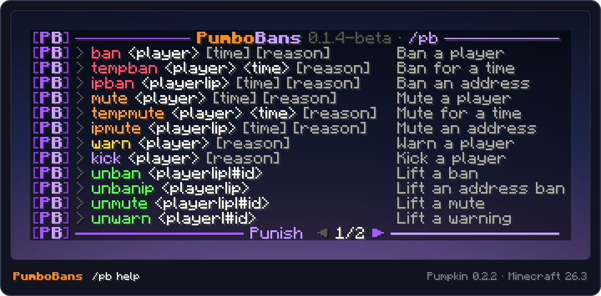

  

<h1 align="center">PumboBans</h1>

Bans, mutes and warnings for Pumpkin servers and PumboProx networks.

  
  
  
  
  
  
  

> [!NOTE]
> PumboBans is still in beta.

  

## Pumpkin versions

Each Pumpkin release loads only its own file:

- Pumpkin 0.2.1+26.3-26.51 and 0.2.2+26.3-26.60: `PumboBans-v<version>-for-Pumpkin-0.2.1-and-0.2.2.wasm`, or the file on the Pumpkin market
- Pumpkin 0.2.0+26.3-26.51: `PumboBans-v<version>-for-Pumpkin-0.2.0.wasm`
- Pumpkin 0.1.0-dev+26.2-26.45: `PumboBans-v<version>-for-Pumpkin-0.1.0-dev.wasm`

The files are in the [latest release](https://github.com/PumboMC/PumboBans/releases/latest).

On Pumpkin 0.2.2 the commands have no Tab completion: Pumpkin 0.2.2 crashes when a player asks a plugin for completions. It comes back with a PumboBans update once Pumpkin fixes this.

Installation: [the steps](docs/installation.md) for PumboProx and for Pumpkin, with two lines for `pumpkin.toml` that hosting panels need.

## Project Pages

- [Screenshots](docs/screenshots.md)
- [Features](docs/features.md)
- [Installation](docs/installation.md)
- [Configuration](docs/configuration.md)
- [Commands](docs/commands.md)
- [Changelog](CHANGELOG.md)

## Development

- For plugin developers: [on Pumpkin](plugins/pumbo-bans-pumpkin/README.md#for-other-plugins), [on PumboProx](plugins/pumbo-bans-prox/README.md#for-other-plugins)
- [Contributing](CONTRIBUTING.md)
- [Bug reports](https://github.com/PumboMC/PumboBans/issues)
- [Security](SECURITY.md)
- [Releases](https://github.com/PumboMC/PumboBans/releases)

## Networks

Running more than one server? [PumboProx](https://github.com/PumboMC/PumboProx) is the proxy for Pumpkin networks, with plugins in WebAssembly. PumboBans runs on it too: one ban covers the whole network, or just the server you name.

## License

PumboBans (the core and both builds) is licensed under the [GNU General Public License v3.0](LICENSE). The shared library for Pumbo plugins (`pumbo-common`) is dual-licensed under MIT and Apache-2.0.

PumboBans is not affiliated with Mojang, Microsoft or the Pumpkin project.
