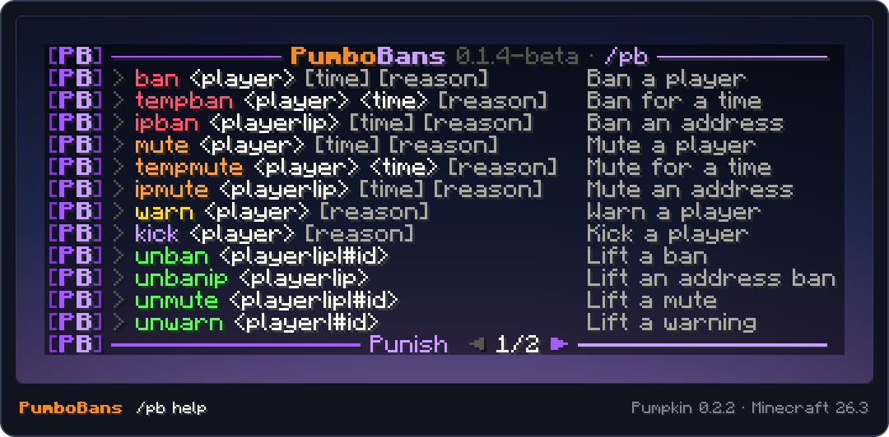

# Commands and permissions

Every command works as `/pumbobans <command>`, or `/pb <command>` for short. The top-level commands below (`/ban`, `/mute`, ...) are aliases you can turn off one by one in `commands.disabled`.

  

| Command | Arguments | Permission |
| --- | --- | --- |
| `/ban` | `<player> [time] [reason\|#template] [-s] [-f]` | `pumbo.bans.ban` |
| `/tempban` | `<player> <time> [reason] [-s] [-f]` | `pumbo.bans.tempban` |
| `/ipban`, `/banip` | `<player\|ip> [time] [reason] [-s]` | `pumbo.bans.ipban` |
| `/mute` | `<player> [time] [reason\|#template] [-s] [-f]` | `pumbo.bans.mute` |
| `/tempmute` | `<player> <time> [reason] [-s] [-f]` | `pumbo.bans.tempmute` |
| `/ipmute` | `<player\|ip> [time] [reason] [-s]` | `pumbo.bans.ipmute` |
| `/warn` | `<player> [reason\|#template] [-s] [-f]` | `pumbo.bans.warn` |
| `/kick` | `<player> [reason] [-s]` | `pumbo.bans.kick` |
| `/unban`, `/unmute` | `<player\|ip\|#id> [-s]` | `pumbo.bans.unban`, `pumbo.bans.unmute` |
| `/unbanip` | `<player\|ip> [-s]` | `pumbo.bans.unbanip` |
| `/unwarn` | `<player\|#id> [-s]` | `pumbo.bans.unwarn` |
| `/history` | `<player\|ip> [page]` | `pumbo.bans.history` |
| `/warns` | `<player>` | `pumbo.bans.warns` |
| `/banlist`, `/mutelist` | `[page]` | `pumbo.bans.banlist`, `pumbo.bans.mutelist` |
| `/checkban` | `<player\|ip>` | `pumbo.bans.check` |
| `/alts` | `<player>` | `pumbo.bans.alts` |
| `/staffhistory` | `<staff\|console> [page]` | `pumbo.bans.staffhistory` |
| `/pumbobans import vanilla` | | `pumbo.bans.admin.import` |
| `/pumbobans purge` | `<player>` | `pumbo.bans.admin.purge` |

Under `/pumbobans` and `/pb` some commands have other names too: `tban` (tempban), `banip` (ipban), `tmute` (tempmute), `muteip` (ipmute), `pardon` (unban), `unipban` (unbanip), `delwarn` (unwarn), `hist` (history), `warnings` (warns), `bans` (banlist), `mutes` (mutelist), `checkban` and `checkmute` (check), `dupeip` (alts), `blame` (staffhistory). `/pumbobans info <#id>` shows one punishment.

`-s` punishes silently (only staff with `notify.silent` see it), `-f` punishes a name that never joined. Without a time, bans and mutes are permanent.

Other permissions: `notify`, `notify.silent`, `notify.alts`, `viewips` (full addresses in `/alts`), `exempt.<ban|mute|warn|kick>`, `exempt.bypass` and `limit.<group>`, all under `pumbo.bans.`.

On PumboProx every command also works from the proxy console. On Pumpkin the permissions are named `pumbobans:<name>` (for example `pumbobans:ban`) and default to operators.
