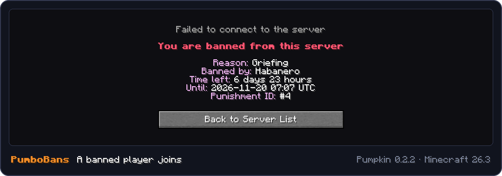

# Features

PumboBans gives your staff bans, mutes, warnings and kicks, with a full history of every punishment. Bans are checked when the player logs in, before they enter the world. On PumboProx one ban covers every server of the network.

| | Feature | |
| --- | --- | --- |
| 🔨 | **Bans** | Permanent bans by account, or by name for players who never joined (`-f`). |
| ⏱️ | **Temporary bans** | Any length: `30m`, `7d`, `1mo`, or combined like `1d12h`. |
| 🌐 | **IP bans** | Ban an address or a range. IPv6 addresses are banned by their /64 network, so the next address does not help. |
| 🔇 | **Mutes** | Chat and message commands (`/msg`, `/tell`, `/me`, ...) are blocked. The player sees why and stays online. |
| ⚠️ | **Warnings** | Warnings count for 30 days (by default) and lead to the next punishment. |
| 👢 | **Kicks** | Disconnect a player with a reason. |
| 📑 | **Templates** | `/ban Steve #cheating` picks the reason and a length that grows with every repeat (7 days, 30 days, permanent). |
| 📈 | **Escalation** | For example 3 active warnings bring a 1 hour mute, 5 bring a 1 day ban. |
| ✉️ | **Appeals** | The ban screen shows the reason, who banned, the time left, the punishment ID and your appeal link. |
| 📜 | **History** | Nothing is deleted. Lifted punishments keep who lifted them and when. Clickable pages in `/history`, `/banlist`, `/mutelist`, `/staffhistory`. |
| 👥 | **Alt accounts** | `/alts` shows accounts that share an address. Four levels decide how far a ban reaches alt accounts. |
| 🛡️ | **Exemptions** | Protect chosen players from a kind of punishment, also while they are offline. |
| 📏 | **Staff limits** | The longest ban or mute each staff group may give. |
| 📥 | **Import** | Takes over vanilla `banned-players.json` and `banned-ips.json` (also from Paper and Pumpkin). |
| 🔔 | **Notifications** | Staff see every punishment, and a notice when someone joins from an address a banned account has used. |
| 🔐 | **Fail closed** | If the database cannot be opened, nobody joins (you can turn this off). |
| 🧹 | **Privacy** | IP addresses are forgotten after 180 days (by default). `/pumbobans purge <player>` removes them on request. |

  

## Works with other Pumbo plugins

PumboBans works on its own. When it finds other Pumbo plugins, it works with them:

| Plugin | Together |
| --- | --- |
| 🛡️ [PumboFilter](https://github.com/PumboMC/PumboFilter) | Places temporary IP bans for addresses that keep failing the bot check, when you allow it in `ipc.allow-punish`. |
| 🔒 [PumboAuth](https://github.com/PumboMC/PumboAuth) | Banned players are refused before the login. On PumboProx a ban also ends the player's sessions. |
| 🌐 [PumboProx](https://github.com/PumboMC/PumboProx) | One ban list for the whole network. Other plugins can ask whether a player is banned or muted, and the placeholder `%pumbobans_muted%` is available. |
