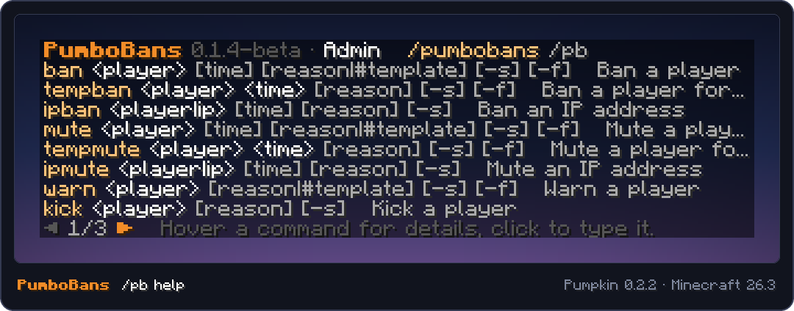
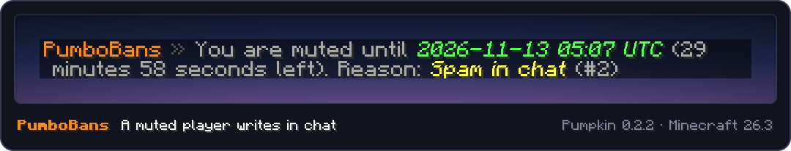
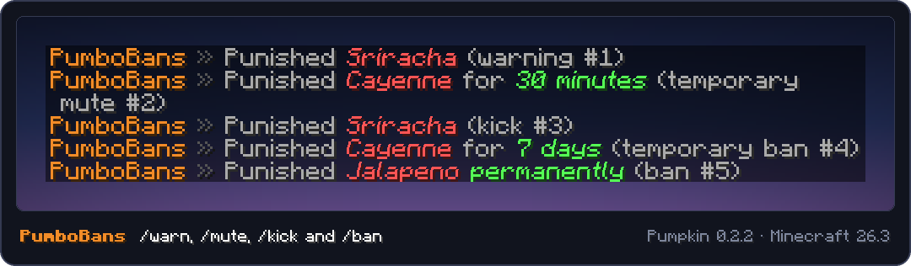
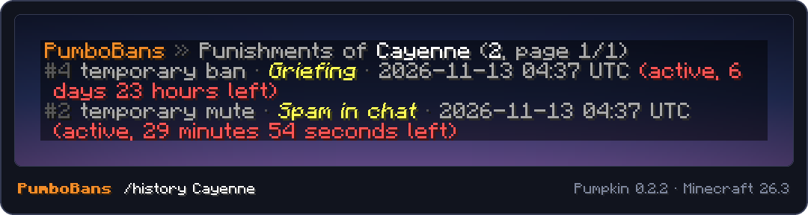
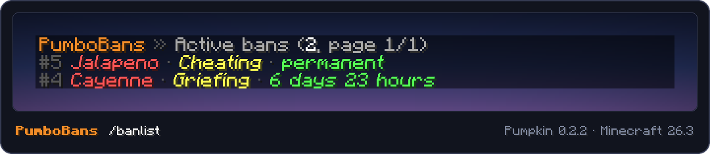
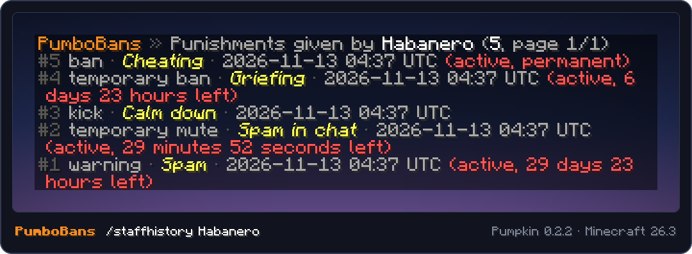
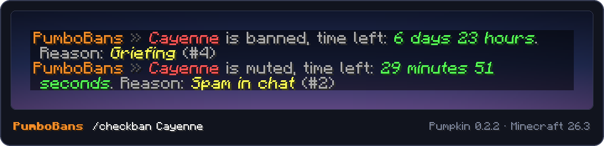
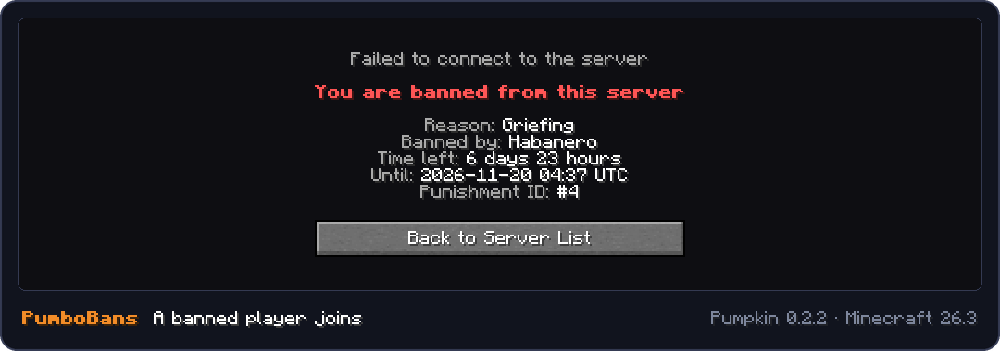

# Screenshots

PumboBans at work. Every picture is drawn from what the plugin sent to a Minecraft 26.3 client on a Pumpkin 0.2.2 server.

## /pb help

  

## A muted player writes in chat

  

## /warn, /mute, /kick and /ban

  

## /history Cayenne

  

## /banlist

  

## /staffhistory Habanero

  

## /checkban Cayenne

  

## A banned player joins

  

