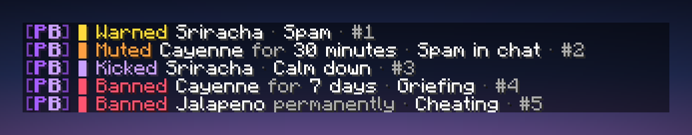
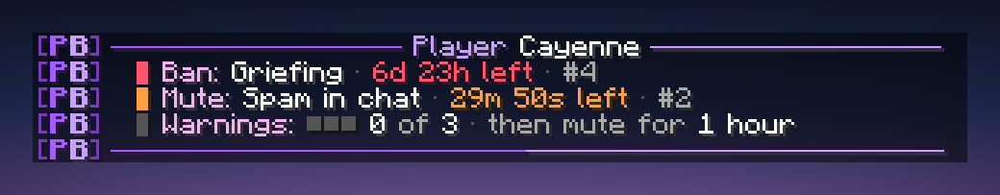
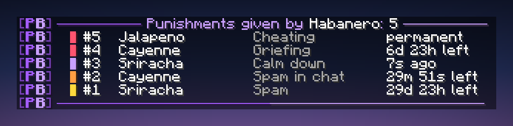
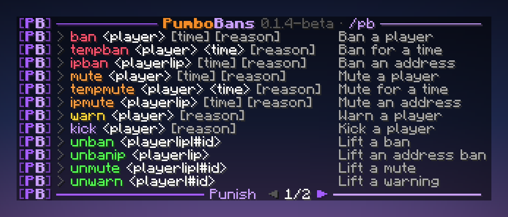

Bans, mutes, warnings and kicks for Pumpkin servers, with a full history of every punishment. PumboBans checks bans at login, before the player enters the world.

> PumboBans is still in beta.

## Features

- **Bans**, permanent or for any length (`30m`, `7d`, `1d12h`), also for players who never joined.
- **IP bans** of an address or a range. IPv6 addresses are banned by their /64 network.
- **Mutes** block chat and message commands. The player sees why and stays online.
- **Warnings** count for 30 days and lead to the next punishment.
- **Templates and escalation.** `/ban Steve #cheating` picks the reason and a length that grows with every repeat. 3 warnings can bring a mute.
- **Full history** with clickable pages. Nothing is deleted.
- **Alt accounts** sharing an address, staff limits and exemptions.
- **Vanilla import** of `banned-players.json` and `banned-ips.json`.

## How it looks

### Warn, mute, kick, ban

Each punishment takes a time and a reason, and gets an ID you can lift it by. Add `-s` to punish silently and `-f` for a player who never joined.

### The ban screen

A banned player sees the reason, the staff member, the time left and the punishment ID. Your appeal link goes on the same screen.

### One player at a glance

`/checkban` shows the active ban, the mute and the warnings of a player. `/history` lists every punishment the player ever got.

### Staff history

`/staffhistory` lists the punishments a staff member gave, the newest first.

## Commands

`/pb help` lists the commands you may use; click one to type it. `/pb` is short for `/pumbobans`. Permissions are named `pumbobans:<name>` and default to operators. The [command list](https://github.com/PumboMC/PumboBans/blob/main/docs/commands.md) has every argument and permission.

## Installation

Drop the file into `plugins/` and start the server. PumboBans creates its config in `plugins/data/pumbobans/`. To take over the bans your server already has, run `/pb import vanilla`.

## Pumpkin versions

Each Pumpkin release loads only its own file:

- Pumpkin 0.2.1+26.3-26.51 and 0.2.2+26.3-26.60: Market download, or `PumboBans-v<version>-for-Pumpkin-0.2.1-and-0.2.2.wasm` from GitHub
- Pumpkin 0.2.0+26.3-26.51: `PumboBans-v<version>-for-Pumpkin-0.2.0.wasm` from GitHub
- Pumpkin 0.1.0-dev+26.2-26.45: `PumboBans-v<version>-for-Pumpkin-0.1.0-dev.wasm` from GitHub

The GitHub files are in the [latest release](https://github.com/PumboMC/PumboBans/releases/latest).

When PumboBans detects Pumpkin 0.2.2, its commands stop suggesting player names, because Pumpkin 0.2.2 crashes when a player asks a plugin for completions. Commands work as before. Suggestions come back with a PumboBans update once Pumpkin ships [a fix](https://github.com/Pumpkin-MC/Pumpkin/pull/4149).

## Running a network?

PumboBans also runs on [PumboProx](https://github.com/PumboMC/PumboProx): one ban covers the whole network, or only the server you name.

## Project Pages

- [Features](https://github.com/PumboMC/PumboBans/blob/main/docs/features.md)
- [Installation](https://github.com/PumboMC/PumboBans/blob/main/docs/installation.md)
- [Configuration](https://github.com/PumboMC/PumboBans/blob/main/docs/configuration.md)
- [Commands](https://github.com/PumboMC/PumboBans/blob/main/docs/commands.md)
- [Changelog](https://github.com/PumboMC/PumboBans/blob/main/CHANGELOG.md)
- [Bug reports](https://github.com/PumboMC/PumboBans/issues)

## License

PumboBans is licensed under the GNU General Public License v3.0. It is not affiliated with Mojang, Microsoft or the Pumpkin project.
